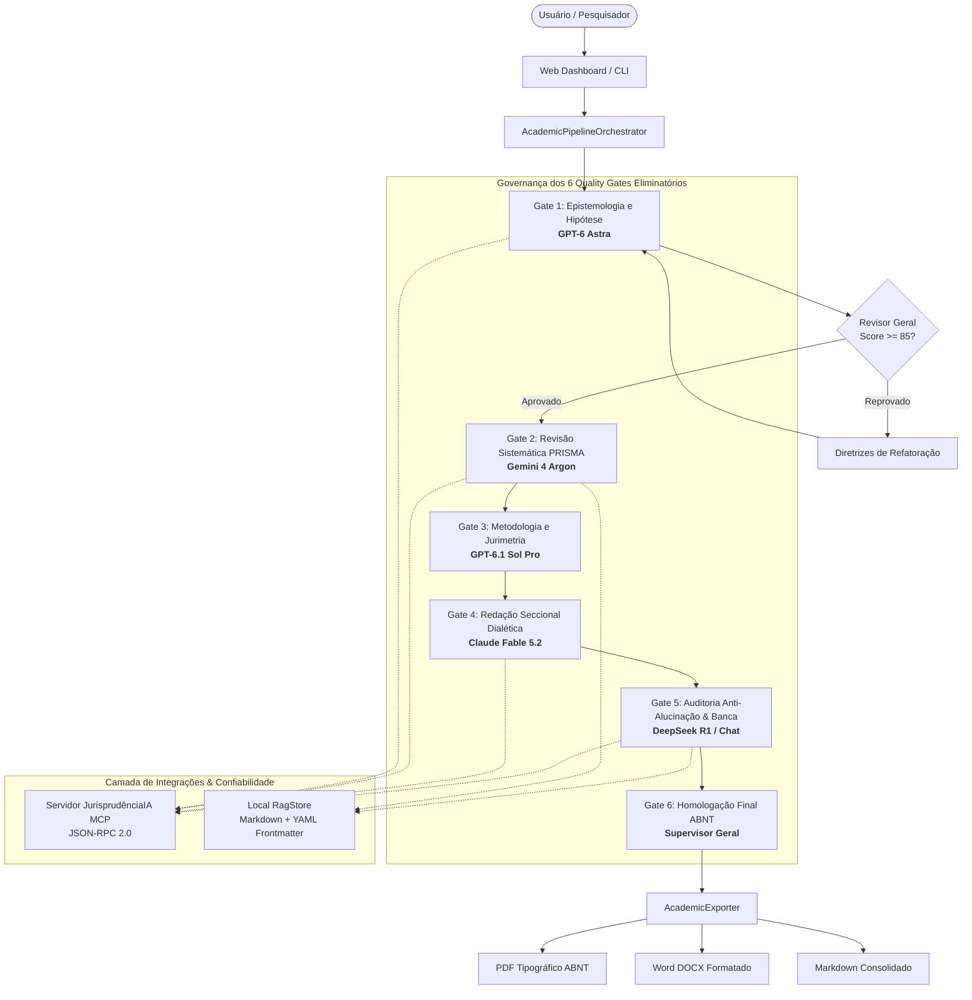

# StrictoSensu · Arquitetura e Especificação Técnica

Plataforma autônoma local de pesquisa jurídica avançada, redação acadêmica de nível *Stricto Sensu* (Doutorado e Mestrado) e geração de artigos científicos de periódico (Qualis A / Scopus) e projetos de tese (ABNT NBR 15287 / 14724), com integração nativa ao servidor **JurisprudênciaIA MCP** e governança por **6 Quality Gates Eliminatórios**.

---

## 1. Visão Geral e Propósito do Sistema

A produção de trabalhos científicos de pós-graduação estrita exige densidade teórica, rigor metodológico, exaustividade bibliográfica e precisão absoluta nas citações dogmáticas e jurisprudenciais. 

O **StrictoSensu** foi projetado para resolver as três patologias crônicas dos modelos de linguagem tradicionais no meio acadêmico:
1. **Alucinação Jurisprudencial e Normativa:** Eliminada através do protocolo Model Context Protocol (MCP) conectado ao servidor oficial de jurisprudência brasileira, garantindo precedentes autênticos com número de processo, relator, tribunal, data e ementa integral.
2. **Superficialidade Argumentativa:** Superada pela divisão de competências entre agentes especialistas orientados a tarefas cognitivas específicas (Epistemologia, RSL/PRISMA, Jurimetria e Confrontação Dialética).
3. **Desarticulação Estrutural:** Mitigada pelo padrão de supervisão hierárquica (*Chief Academic Reviewer / Supervisor Pattern*), no qual cada transição de etapa depende de aprovação em matriz de avaliação multidimensional (0 a 100, limiar 85.0).

---

## 2. Arquitetura Multi-Agente & Matriz de Modelos

O sistema opera sob uma arquitetura de múltiplos agentes especializados orquestrados via máquina de estados assíncrona. Cada agente é fixado ao modelo de fundação mais qualificado para a sua natureza epistêmica:



### Funções dos Agentes Especialistas:

| Agente | Arquivo Fonte | Modelo Padrão | Responsabilidade Epistêmica |
| :--- | :--- | :--- | :--- |
| **Agente Epistemológico** | `src/agents/epistemic_agent.py` | `openai/gpt-6-astra` | Formulação do problema de pesquisa, hipótese falseável, justificação de ineditismo e mapeamento de viragens (*overruling*). |
| **Agente de Literatura** | `src/agents/literature_review_agent.py` | `google/gemini-4-argon` | Condução da Revisão Sistemática de Literatura (RSL/PRISMA), tripé doutrinário (clássico, contemporâneo e comparado) e indexação no RAG. |
| **Agente Metodológico** | `src/agents/methodology_agent.py` | `openai/gpt-6.1-sol-pro` | Desenho metodológico quanti-qualitativo, amostragem jurimétrica e critérios empíricos de inclusão/exclusão. |
| **Agente Redator Seccional** | `src/agents/sectional_writer_agent.py` | `anthropic/claude-fable-5.2` | Redação dos capítulos analíticos com prosa culta e sóbria, confrontação dialética e citação contextualizada de precedentes. |
| **Auditor de Defesa (Banca)** | `src/agents/defense_validator_agent.py` | `deepseek/deepseek-chat` | Confronto anti-alucinação de processos contra o acervo RAG e simulação adversarial da banca examinadora de qualificação/defesa. |
| **Revisor Geral (Supervisor)** | `src/agents/chief_academic_reviewer.py` | Lógica Algorítmica Determinística | Cálculo da matriz multidimensional em 4 eixos, emissão de pareceres e autorização/bloqueio de avanço. |

---

## 3. Os 6 Quality Gates Eliminatórios

O pipeline é rigorosamente sequencial. O avanço para a etapa seguinte só ocorre quando o **Revisor Geral** emite `autorizacao_avanco = True` com pontuação igual ou superior à nota de corte (padrão: **85.0 / 100**).

1. **Gate 1 — Epistemologia & Problematização:**
   - **Critérios:** Formulação de problema de pesquisa genuíno, hipótese refutável com resposta dogmática sustentável (mínimo 40 palavras) e justificativa de contemporaneidade/ineditismo.
2. **Gate 2 — Revisão Bibliográfica Sistemática (PRISMA) & MCP:**
   - **Critérios:** Tripé doutrinário explícito, cronologia histórica dos precedentes judiciais e indexação de acórdãos paradigmas no `RagStore`.
3. **Gate 3 — Metodologia & Jurimetria Empírica:**
   - **Critérios:** Desenho metodológico consistente com a hipótese, delimitação amostral de acórdãos e categorização estatística/jurimétrica descritiva.
4. **Gate 4 — Redação Seccional Dialética:**
   - **Critérios:** Estrutura capitular rigorosamente ordenada (Seção 1 "Introdução" como primeiro capítulo obrigatório, repelindo subversões estruturais), conformidade com o tipo documental (ABNT NBR 6022 para artigos de periódico ou NBR 15287 / 14724 para projetos de tese), redação em prosa dissertativa contínua e sóbria.
   - **Travas Automatizadas:** 
     - *Auditoria Anti-Vazamento:* Reprovação imediata na presença de resíduos de ferramentas RAG, logs de APIs ou comandos de prompt.
     - *Decoro Acadêmico & Estilo:* Bloqueio contra tom esquemático (proporção de linhas em listas/bullets limitada a no máximo 15%).
     - *Ordenação Canônica:* Reprovação se a Introdução não for o primeiro capítulo do corpo do texto.
5. **Gate 5 — Auditoria Anti-Alucinação & Banca Examinadora Sintética:**
   - **Critérios:** Auditoria automatizada por Expressões Regulares (`REsp`, `AREsp`, `RE`, `ADI`, `ADC`, etc.) validando se todo processo citado no texto existe no acervo indexado. Emissão de parecer crítico sobre pontos de vulnerabilidade dogmática (*distinguishing*).
6. **Gate 6 — Homologação Final para Compilação ABNT:**
   - **Critérios:** Verificação de completude estrutural conforme a **ABNT NBR 6022**:
     - *Elemento de Autoria e Filiação:* Autores identificados com credenciais e filiação institucional.
     - *Resumo Vernáculo (ABNT NBR 6028):* Parágrafo único contínuo com objetivo, metodologia e conclusões, seguido de palavras-chave separadas por ponto.
     - *Abstract em Língua Estrangeira:* Tradução acadêmica do resumo acompanhada de *Keywords*.
     - *Higiene Normativa Global:* Auditoria cruzada final no texto consolidado para certificar a ausência total de metadados ou comandos de depuração.
     - *Referências (ABNT NBR 6023):* Bibliografia e jurisprudência contextualmente integradas ao tema.

---

## 4. Integração com o Servidor JurisprudênciaIA MCP

O cliente `JurisprudenciaMcpClient` (`src/mcp_client.py`) conecta-se via JSON-RPC 2.0 assíncrono (HTTP/HTTPS) a endpoints remotos ou locais, disponibilizando um conjunto especializado de operações jurídicas:

- `buscar_precedentes_qualificados`: Localiza acórdãos com eficácia vinculante (Temas Repetitivos, Repercussão Geral, Súmulas).
- `pesquisar_jurisprudencia`: Busca textual ampla com fallback resiliente caso ferramentas específicas sofram *timeout*.
- `listar_overruling_tema`: Detecta viragens de entendimento jurisprudencial que conferem ineditismo à tese.
- `analisar_jurimetria`: Extrai métricas de tempo de julgamento, dispersão decisória entre turmas e tendências decisórias.
- `analisar_tese_juridica`: Submete a hipótese da tese contra os precedentes dominantes, gerando pontos de cautela para o Gate 5.

---

## 5. Módulo de Refatoração e Elevação de Papers Existentes

Além da geração a partir de tema, o sistema possui o pipeline **`AcademicPaperImprover`** (`src/improver.py` e `src/importer.py`):
1. **Ingestão Multi-Formato:** Extrai texto integral e estrutura de arquivos PDF (`pypdf`), DOCX (`python-docx`), Markdown e Texto plano.
2. **Diagnóstico Pré-Intervenção:** A Banca Examinadora Sintética analisa as fragilidades do rascunho original e emite uma nota de corte inicial.
3. **Saneamento Jurisprudencial:** Acórdãos desatualizados ou incompletos são validados e substituídos por precedentes vigentes do MCP.
4. **Reescrita e Elevação para Doutorado:** Seções vulneráveis são reescritas com densidade conceitual pelo Agente Redator.
5. **Geração do Dossiê da Banca:** Gera um documento técnico autônomo com o comparativo de notas antes/depois, histórico de intervenções e parecer de defesa.

---

## 6. Motor Tipográfico e Exportação ABNT

O `AcademicExporter` (`src/exporter.py`) consolida os estados acadêmicos e produz três saídas prontas para protocolo em estrita conformidade com a **ABNT NBR 6022:2018** (artigos) e **NBR 14724:2011** (trabalhos acadêmicos/teses):

1. **Ordenação Canônica Obrigatória:** Implementada via `_ordenar_chaves_capitulos`, garantindo matematicamente a sequência:
   - Seção 1: *Introdução e Problematização Epistemológica*;
   - Seção 2: *Marco Teórico e Confrontação Dialética*;
   - Seção 3: *Análise Empírico-Jurisprudencial e Hermenêutica Decisória*;
   - Seção 4: *Considerações Finais e Perspectivas Epistemológicas*.
2. **Estrutura de Elementos Pré-Textuais:**
   - Título e subtítulo no vernáculo;
   - Nome dos autores com nota de qualificação acadêmica (titulação) e filiação institucional;
   - Resumo no vernáculo de parágrafo único contínuo com 150 a 250 palavras (NBR 6028) e palavras-chave separadas por ponto;
   - *Abstract* em língua estrangeira (inglês) com *Keywords* padronizadas;
3. **Referências Normatizadas (ABNT NBR 6023:2018):**
   - Sistema de montagem bibliográfica e jurisprudencial sensível ao contexto temático (ex.: legislação federal, convenções internacionais, precedentes vinculantes do STF/STJ como o Tema Repetitivo 1.249/STJ, e doutrina clássica/contemporânea especializada).
4. **Formatos de Saída:**
   - **Markdown (.md):** Texto íntegro estruturado com títulos numerados, citações em bloco com recuo e referências bibliográficas.
   - **PDF Nativo ABNT (.pdf):** Diagramação tipográfica em papel A4 com margens regulamentares (superior e esquerda de 3 cm; inferior e direita de 2 cm), tipografia Times proporcional, espaçamento entrelinhas de 1,5 e recuo de 4 cm para citações longas (mais de 3 linhas), com suporte a compilação nativa via LaTeX/Tectonic ou motor PDF nativo Python.
   - **DOCX Editável (.docx):** Documento Microsoft Word com estilos corporativos, sumário estruturado e tabelas formatadas.

---

## 7. Módulo de Higiene Acadêmica e Sanitização (`src/sanitizer.py`)

Para eliminar o vazamento de logs de operação do RAG, comandos de prompt e respostas brutas de APIs, foi desenvolvido um componente universal e determinístico composto por quatro funções centrais:

- **`sanitizar_texto_academico(texto: str) -> str`:**
  - Aplica filtros léxicos e expressões regulares para expurgar cabeçalhos de depuração (`# Resultado JurisprudenciaIA`), avisos de ausência de metadados (`• Metadados ausentes: inteiro teor`), carimbos de data/hora (`Executado em: YYYY-MM-DD...`), URLs de busca interna de tribunais (`scon.stj.jus.br`) e marcadores mecânicos não resolvidos (`[J1 - STF]`).
  - Descarta cabeçalhos processuais em caixa alta colados mecanicamente e converte ementas longas em sínteses doutrinárias fluidas.
- **`verificar_vazamentos(texto: str) -> List[str]`:**
  - Inspeciona exaustivamente o documento contra a lista `TERMOS_PROIBIDOS_VAZAMENTO`, identificando violações para reprovação imediata nos Gates 4 e 6.
- **`calcular_proporcao_bullets(texto: str) -> float`:**
  - Calcula a densidade de linhas estruturadas como tópicos ou listas (`-`, `*`, `•`, numerações isoladas), diferenciando-as semanticamente de títulos acadêmicos legítimos de seções (`1. Introdução`, `2. Marco`, etc.). O limiar de 15% bloqueia estilos redacionais excessivamente esquemáticos.
- **`converter_dados_jurimetria_em_prosa(dados_raw: str, tema: str) -> str`:**
  - Transforma tabelas brutas, contadores estatísticos e fichas de busca jurimétrica em prosa dissertativa fluida e analítica.

---

## 8. Estrutura do Repositório

```text
c:\App_Artigos_Cientificos\
├── corpus/                 # Acervo local de precedentes RAG em Markdown + YAML
├── docs/                   # Documentação técnica e manuais de engenharia
│   ├── especificacao_tecnica_strictosensu.md
│   └── memoria.md
├── drafts/                 # Rascunhos intermediários e arquivos de trabalho
├── output/                 # Documentos finais homologados (.pdf, .docx, .md)
├── specs/                  # Especificações executáveis do Spec Kit (001-phd-articles-pipeline)
├── src/
│   ├── agents/             # Os 6 Agentes Especialistas e o Revisor Geral
│   ├── static/             # Frontend Dashboard (HTML5, CSS3, JS Vanilla sem dependências externas)
│   ├── cli.py              # Interface de Linha de Comando (CLI com Typer e Rich)
│   ├── config.py           # Configurações de ambiente, modelos e timeouts
│   ├── exporter.py         # Compilador e gerador ABNT (PDF/DOCX/MD com ordenação canônica)
│   ├── importer.py         # Extrator multi-formato de manuscritos (PDF/DOCX/MD/TXT)
│   ├── improver.py         # Orquestrador do modo de refatoração e elevação de papers
│   ├── llm.py              # Cliente OpenRouter assíncrono com retries e fallbacks
│   ├── mcp_client.py       # Cliente JSON-RPC 2.0 do JurisprudênciaIA MCP
│   ├── orchestrator.py     # Máquina de estados central dos 6 Quality Gates
│   ├── rag_store.py        # Gerenciador de metadados e persistência de precedentes
│   ├── sanitizer.py        # Sanitizador universal de logs, bullets e vazamentos de RAG
│   ├── schemas.py          # Schemas Pydantic v2 (DTOs, Enums, ABNT State)
│   ├── web.py              # Backend FastAPI com endpoints REST e Streaming de Jobs
│   └── web_researcher.py   # Módulo de pesquisa acadêmica profunda na web (OpenAlex, Crossref, BDJur, SciELO)
└── tests/                  # Bateria de testes automatizados (Pytest / AsyncIO)
    ├── test_improver.py
    ├── test_llm.py
    ├── test_mcp_client.py
    ├── test_orchestrator.py
    ├── test_reviewer_gates.py
    ├── test_sanitizer_and_abnt_nbr6022.py
    ├── test_schemas.py
    ├── test_web_and_pdf.py
    └── test_web_researcher.py
```

---

## 9. Guia Rápido de Operação

### 9.1. Execução via Interface Web
Para iniciar o servidor web local com painel operacional:
```powershell
python -m src.cli web --host 127.0.0.1 --port 8000
```
Acesse no navegador: `http://127.0.0.1:8000`.

### 9.2. Execução via Linha de Comando (CLI)
Para gerar um artigo acadêmico diretamente pelo terminal com telemetria em tempo real:
```powershell
python -m src.cli run --titulo "O Princípio da Confiança Legítima no Overruling Tributário" --tema "Overruling e Modulação de Efeitos pelo STF e STJ"
```

Para auditar e elevar um paper existente:
```powershell
python -m src.cli improve --arquivo "caminho/para/meu_paper.docx" --tipo ARTIGO_CIENTIFICO
```

### 9.3. Execução da Suíte de Testes
Para rodar a verificação de integridade e regressão:
```powershell
python -m pytest -q
```
*Garantia de 46 testes automatizados aprovados (100% de cobertura funcional e testes de regressão dos módulos principais, incluindo pesquisa acadêmica web profunda).*
